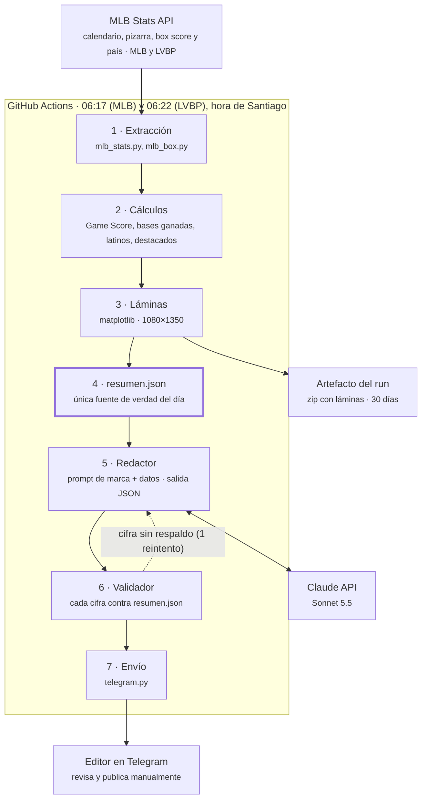

# Arquitectura del agente de resultados

> Documento técnico de **Beisbol Para Todos** (`bpt`), el toolkit de datos de @mbp.deportes.
> Versión del sistema: 0.5.0 · Actualizado: 12 de octubre de 2026.

## Resumen

El sistema es una redacción automática. Cada madrugada descarga los resultados de MLB y de la LVBP, genera las láminas, solicita a Claude los textos para redes sociales, verifica que cada cifra sea correcta y envía el paquete por Telegram antes de las 07:00 (hora de Santiago). La publicación sigue siendo manual: el editor revisa y publica.

**Problema que resuelve.** Una cuenta de datos depende de publicar temprano y sin errores. El trabajo manual diario es lento y repetitivo, y la fatiga es la principal fuente de errores. El sistema automatiza lo repetitivo y reserva para el editor lo que no se delega: el criterio editorial y la decisión de publicar.

**Recorrido diario:**

1. **06:17 (MLB) y 06:22 (LVBP), hora de Santiago.** GitHub Actions inicia el proceso mediante un cron.
2. **Datos.** Se consultan en la MLB Stats API los juegos del día anterior, el box score de cada uno y, en MLB, el país de nacimiento de cada pelotero.
3. **Cálculos.** Se obtienen las figuras (Game Score, bases ganadas), los latinos destacados en MLB y los destacados de la jornada en la LVBP.
4. **Láminas.** Se generan las imágenes de 1080×1350 con la identidad visual de MBP.
5. **Resumen.** Todas las cifras del día se guardan en un `resumen.json`, la única fuente de verdad para los pasos siguientes.
6. **Redacción.** Claude escribe el caption, el hilo y el guion usando exclusivamente ese JSON.
7. **Validación.** Un programa compara cada número del texto con el JSON. Si alguno no coincide, se devuelve a Claude una vez; si persiste, la pieza se marca "con alertas".
8. **Entrega.** El paquete llega a Telegram, ordenado para copiar y pegar. Nada se publica sin aprobación.

**Principio rector:** el sistema propone y el editor decide. Ninguna pieza llega a redes sin revisión humana.

## Arquitectura

Es un pipeline lineal con un único ciclo de retorno, el del validador. Se ejecuta completo dentro de GitHub Actions y se comunica con tres servicios externos: la MLB Stats API, la API de Claude y Telegram.

El componente clave es el paso 4: separa lo que se **calcula** de lo que se **cuenta**. El redactor nunca accede a la API de MLB, solo al `resumen.json`; por eso el validador puede contrastar todo contra un único archivo.

Los secretos (`ANTHROPIC_API_KEY`, `TELEGRAM_BOT_TOKEN`, `TELEGRAM_CHAT_ID`) se inyectan al runner desde GitHub Secrets.

## Construcción, en orden

El sistema se construyó por capas, de abajo hacia arriba: datos, visualización, redacción y automatización. Cada capa se probó antes de construir la siguiente, de modo que ante una falla se sabe en qué nivel buscar.

1. **Extracción de MLB** (`bpt/data/mlb_stats.py`). Una sola consulta al calendario de la postemporada entrega marcador, pizarra por entradas y decisiones. El estado de cada serie se calcula a partir de los juegos terminados, sin depender de textos de la API.
2. **Lámina de resultado** (`bpt/viz/result_card.py`). Se dibuja con matplotlib, que ya usaban las otras tarjetas, y con la identidad "Dashboard de dugout" (`bpt/theme.py`).
3. **`resumen.json`** (`bpt/resultados.py`). Separa el cálculo de la narración: todo lo que se publica sale de este archivo. Un cambio de redactor o de canal no lo afecta.
4. **Figuras del juego** (`bpt/data/mlb_box.py`). Del box score se obtienen la mejor salida en la loma (Game Score) y la mejor línea al bate (bases ganadas), con el criterio impreso en la lámina.
5. **Agente redactor** (`bpt/redactor/`). Tres módulos: el prompt de marca (`prompt.py`), la llamada a Claude con salida estructurada (`agente.py`) y el validador de cifras (`validador.py`).
6. **Latinos en el juego** (`bpt/data/mlb_people.py`). El box score no incluye el país; se consulta aparte y se guarda en caché de forma permanente.
7. **Automatización** (`.github/workflows/resultados-mlb.yml`). GitHub Actions ejecuta el proceso cada mañana en una máquina limpia, con las credenciales como secretos.
8. **Telegram** (`bpt/notificar/telegram.py`). El paquete del día llega al teléfono, con cada pieza en un mensaje independiente.
9. **LVBP** (`bpt/lvbp_resultados.py`, `bpt/viz/jornada_card.py`). La misma API cubre la liga 135. Se reutilizó casi todo y se cambió el formato: un carrusel por jornada en lugar de uno por juego.
10. **Ajustes de operación.** Horario a las 06:00, acciones de GitHub actualizadas a Node 24 y runner fijado en Ubuntu 24.04.

En cifras: 6 versiones (de la 0.1.0 a la 0.4.1) y 112 pruebas automáticas.

## Decisiones de diseño

Cada decisión implicó un compromiso. La tabla resume las principales; a continuación se detalla la que más consultas genera.

| Decisión | Elección | Alternativa | Motivo | Costo |
| --- | --- | --- | --- | --- |
| Fuente de datos | MLB Stats API (`statsapi.mlb.com`) | Scraping web, Baseball Savant | JSON oficial y estable; incluye MLB y la LVBP (liga 135) con box score | No está documentada para terceros: puede cambiar sin aviso |
| Ejecución | GitHub Actions con cron | Cloud Run (GCP), servidor propio, equipo local | Gratuito a este volumen, el repositorio ya está ahí, máquina limpia en cada corrida | El cron puede retrasarse; no sirve para escuchar eventos (Fase 4) |
| Visualización | matplotlib (Python) | Canva, Figma, plantillas HTML | Generación automática y consistente, con los datos integrados | Diseñar en código es más lento que en una herramienta visual |
| Redacción | Claude (Sonnet 5.5) por API | Gemini mediante Google AI Studio, plantillas fijas | Ver detalle abajo | Pago por uso, del orden de centavos por día (estimado) |
| Control de calidad | Validador de cifras propio | Confiar en el modelo | Una cifra falsa publicada afecta la credibilidad de la marca | Falsos positivos ocasionales; no detecta números escritos en letras |
| Notificación | Bot de Telegram | WhatsApp Business, correo | Gratuito, sin número dedicado, álbumes de 10 imágenes sin compresión | Telegram es menos usado que WhatsApp en Venezuela |
| Publicación | Manual, con aprobación | Automática desde el inicio | Primero validar qué formatos funcionan; nada sale sin revisión | Algunos minutos diarios del editor |
| Ramas de Git | GitFlow (`main`, `develop`, `feature/*`, `release/*`, `hotfix/*`) | Todo directo en `main` | `main` es producción: solo entra lo probado | Más pasos por cambio |
| Formato LVBP | Un carrusel por jornada | Uno por juego, como en MLB | Unos 4 juegos diarios; 4 publicaciones al día saturarían la cuenta | Menos detalle por juego (disponible en los extras para historias) |

### ¿Por qué Claude y no Google AI Studio?

**Google AI Studio es un entorno de pruebas, no un proceso autónomo.** Es una aplicación web para probar prompts con Gemini y obtener una llave de su API. Lo que se ejecuta cada mañana no es el modelo, sino el programa propio, que llama a un modelo como un componente más. Ese componente vive en un solo archivo (`bpt/redactor/agente.py`), por lo que reemplazarlo es un cambio acotado.

**A favor de Gemini:** dispone de un plan gratuito con modelos Flash competentes ([precios de la Gemini API](https://ai.google.dev/gemini-api/docs/pricing)), suficientes para textos cortos.

**En contra, para este caso:** en el plan gratuito, Google indica que el contenido se utiliza para mejorar sus productos; para evitarlo se requiere el plan de pago, con lo que la diferencia de costo frente a Claude deja de ser relevante. El plan gratuito tiene, además, límites de uso sujetos a cambios.

**Motivo de la elección:** el proyecto ya se desarrollaba con Claude, la salida estructurada con esquema JSON funcionó desde el primer intento y la voz venezolana quedó ajustada en dos iteraciones. Con un costo de centavos diarios, cambiar de modelo no compensa el riesgo de reajustar la voz.

**Lo que no depende del modelo: el validador.** Ningún modelo es confiable con las cifras por sí solo. La garantía la da el código que compara cada número con el `resumen.json`.

## Errores encontrados y aprendizajes

En dos días aparecieron 13 errores reales, y cada uno quedó cubierto por una prueba. La mitad no se manifestaba con datos de prueba: surgieron con datos reales, en Windows o contra la API real. Por eso cada capa se valida contra la realidad lo antes posible.

| Fecha | Incidente | Aprendizaje |
| --- | --- | --- |
| 12-oct-2026 | Telegram rechaza un álbum de un solo archivo (exige entre 2 y 10) | Conocer los límites de cada API; el caso borde aparece cuando falla otra cosa |
| 12-oct-2026 | Una prueba usaba `hash()` como id de equipo y fallaba de forma intermitente | Una prueba intermitente tiene una causa aleatoria: hay que encontrarla, no reintentar |
| 12-oct-2026 | La API identifica como "CAR" a los Leones del Caracas | Identificar por id, nunca por nombre o sigla |
| 12-oct-2026 | Los "destacados" en la loma eran salidas con Game Score de 35 y 28 | Una métrica sin umbral convierte lo peor en "lo mejor del día" |
| 12-oct-2026 | Un relevista de una entrada aparecía como "la mejor salida" | Cada métrica tiene un dominio: el Game Score aplica a salidas largas |
| 12-oct-2026 | El redactor llamó "criollo" a un pelotero dominicano | Las reglas de marca también se validan con código, no solo en el prompt |
| 12-oct-2026 | Escribió "la diferencia la hizo un jonrón" sin datos de jugada por jugada | Un texto puede tener todas las cifras correctas y aun así afirmar algo falso |
| 12-oct-2026 | Respuesta vacía: el razonamiento del modelo agotó los 2.500 tokens | El razonamiento cuenta dentro del límite; hay que dejar margen |
| 12-oct-2026 | Sonnet 5.5 rechazó forzar una herramienta (`tool_choice`) | Las APIs cambian: verificar contra la documentación vigente |
| 12-oct-2026 | Error 401 por una llave de ejemplo heredada en la sesión de PowerShell | Definir la precedencia de configuración (`.env`) y mostrar los últimos 4 caracteres para diagnosticar |
| 12-oct-2026 | Con `--fase D`, el resumen quedaba vacío sin explicación | El error más grave es el silencioso: si no hay resultados, el programa debe indicar por qué |
| 11-oct-2026 | En Windows, matplotlib intentaba abrir ventanas y fallaba | El equipo local no es el servidor: fijar el modo sin pantalla ("Agg") |
| 11-oct-2026 | Dos series divisionales simultáneas se mezclaban: "empatada 2-2" con LAD arriba 2-1 | Un nombre no es un identificador: la serie se identifica por fase y equipos |

El patrón es claro: casi ningún error fue de lógica compleja. Fueron supuestos sobre el entorno ("el nombre es único", "el modelo no inventa", "el entorno está limpio") que la realidad desmintió. Contrastar la lámina contra el box score oficial es el hábito que permitió detectarlos.

## Seguridad y secretos

El sistema usa tres secretos; ninguno está en el código. Cada uno se almacena en dos lugares: el `.env` local para la operación manual y los *secrets* de GitHub para la automática.

| Secreto | Uso | Riesgo si se filtra | Revocación |
| --- | --- | --- | --- |
| `ANTHROPIC_API_KEY` | Llamadas del redactor a Claude | Consumo del crédito por terceros | Consola de Claude → Settings → API keys → eliminar y crear otra |
| `TELEGRAM_BOT_TOKEN` | Envío de mensajes del bot | Suplantación del bot | @BotFather → `/revoke` |
| `TELEGRAM_CHAT_ID` | Destinatario del bot | Bajo por sí solo; no se publica | Cambiar en `.env` y en GitHub |

Prácticas aplicadas:

- **`.env` está en `.gitignore`.** En el repositorio solo existe `.env.example`, con valores ficticios.
- **`.env` tiene precedencia sobre el entorno.** Una variable antigua en la sesión se ignora y se advierte.
- **Los errores nunca muestran un secreto completo.** De la llave de Claude solo se muestran los últimos 4 caracteres; el token de Telegram se elimina de cualquier mensaje de error, verificado por una prueba.
- **Una llave por proyecto.** La de MBP es independiente de cualquier otra; revocarla no afecta otros sistemas.
- **Permisos mínimos en GitHub Actions** (`contents: read`): el workflow puede leer el repositorio, no modificarlo.
- **Crédito prepago con recarga automática desactivada.** El peor escenario ante una filtración es perder ese saldo, no una factura abierta.

## Operación diaria

En un día normal no se requiere ninguna acción hasta recibir el mensaje de Telegram. Ambos workflows se ejecutan solos y, ante una falla, el bot envía el enlace a la ejecución afectada.

| Hora (Santiago) | Evento | Período |
| --- | --- | --- |
| 06:17 | Workflow **Resultados MLB**: juegos del día anterior (hora del Este), todas las fases | Octubre y noviembre |
| 06:22 | Workflow **Resultados LVBP**: jornada del día anterior (hora de Venezuela) | Octubre a enero |
| ~06:30 | Llegada de los paquetes a Telegram | — |
| 07:30 a 08:30 | Revisión y publicación, cuando la audiencia en Venezuela se conecta | — |

Ante una anomalía:

- **No llegó nada a las 06:40.** GitHub puede retrasar los cron; si a las 07:30 no hay mensaje, revisar la ejecución en Actions.
- **Llegó "con alertas".** La alerta indica la cifra o frase observada. Corregir el texto antes de publicar; las láminas no cambian.
- **Llegó "sin textos".** Falló el redactor (crédito agotado, llave revocada o API no disponible). Las láminas siguen siendo válidas; ejecutar `bpt llave` para diagnosticar.
- **Una cifra no coincide con el box score oficial.** No publicar y reportar el juego y la diferencia. Puede tratarse de una corrección del anotador oficial posterior a la ejecución.
- **Repetir un día.** Actions → workflow → *Run workflow* → fecha, o localmente con los comandos siguientes.

Comandos habituales, desde la carpeta del proyecto con el entorno virtual activo:

| Comando | Uso |
| --- | --- |
| `python -m bpt mlb-resultados --fecha 2026-10-12 --redactar` | Regenerar un día de MLB con textos |
| `python -m bpt lvbp-resultados --fecha 2026-10-12 --redactar` | Regenerar una jornada de la LVBP con textos |
| `python -m bpt notificar --fecha 2026-10-12` | Enviar a Telegram un día de MLB (`--salida output/resultados/lvbp` para la LVBP) |
| `python -m bpt llave` | Verificar la llave de Claude sin consumir crédito |
| `python -m bpt telegram-prueba` | Confirmar que el bot puede enviar mensajes |
| `python -m pytest -q` | Ejecutar las 112 pruebas antes de cualquier cambio |

Las fechas usan formato año-mes-día (`2026-10-12`). Las fechas futuras se rechazan para evitar confusiones como `2026-12-10` en lugar del 12 de octubre.

## Costos, límites y hoja de ruta

El único costo variable es Claude, estimado en pocos dólares mensuales. Es una estimación: debe contrastarse en *Settings → Billing* de la Consola tras la primera semana.

| Componente | Costo | Base del cálculo |
| --- | --- | --- |
| Claude Sonnet 5.5 | ~US$ 0,04 por pieza; US$ 3 a 5 al mes | Precio de lista: US$ 2 por millón de tokens de entrada y US$ 10 de salida; supuesto: ~4.000 de entrada y ~3.000 de salida por pieza, 3 piezas diarias |
| GitHub Actions | US$ 0 | Dos ejecuciones breves al día, dentro de los minutos gratuitos del plan |
| MLB Stats API | US$ 0 | Uso público, sin llave |
| Telegram | US$ 0 | API de bots gratuita |

**Prompt caching.** Lo único que se repite entre llamadas es el prompt de sistema (~1.400 tokens; el mínimo cacheable en Sonnet 5.5 es 512). Escribir el caché cuesta 1,25 veces la entrada normal, leerlo el 5 %, y dura 5 minutos. Por eso se activa solo cuando la corrida hará 2 o más llamadas: con 2 juegos el ahorro es de unos US$ 0,002 diarios, porque el costo lo domina la salida. Pasa a ser relevante con volumen alto (temporada regular de MLB, ~15 juegos diarios) o con conversaciones de edición en la Fase 4. Cada pieza registra sus tokens y su costo estimado en `textos.json` y el total diario en `uso.json`, para contrastar la estimación con el consumo real.

| Escenario diario | Sin caché | Con caché | Diferencia |
| --- | --- | --- | --- |
| 1 llamada (LVBP, o MLB con 1 juego) | US$ 0,036 | US$ 0,037 | +US$ 0,0007 (por eso no se activa) |
| 2 llamadas (MLB con 2 juegos) | US$ 0,072 | US$ 0,070 | −US$ 0,002 |

Supuestos de la tabla: 3.000 tokens de entrada (1.400 de sistema) y 3.000 de salida por llamada, a precio de lista de Sonnet 5.5.

Límites conocidos:

- **La MLB Stats API no tiene un contrato de servicio.** Un cambio de esquema rompe la extracción. La mitigación son las pruebas con datos reales y la alerta por Telegram ante fallas.
- **El validador revisa cifras, no ideas.** Detecta números inventados y afirmaciones causales, pero el tono o una valoración exagerada requieren revisión humana.
- **Sin jugada por jugada no se narra el desarrollo del juego** (batazo decisivo, entrada de cada jonrón). La API lo ofrece; es una mejora posible.

Hoja de ruta:

1. **Fase 0, operación manual** — en curso: publicación manual durante algunas semanas para identificar los formatos con mejor respuesta.
2. **Fase 1, datos y láminas automáticas** — completada.
3. **Fase 2, agente redactor con validador** — completada.
4. **Fase 3, aprobación desde el teléfono** — completada con Telegram, en modalidad de revisión y publicación manual.
5. **Fase 4, publicación** — pendiente. Botón "Aprobar" en Telegram que publique en Instagram (sin costo, con trámite en Meta) y luego en X (pago por uso). Requiere un servicio permanente, por ejemplo un Cloud Run.
6. **Fase 5, métricas** — pendiente. Resumen semanal de alcance y guardados para que el redactor aprenda de lo que funcionó.

## Glosario

| Término | Definición |
| --- | --- |
| API | Interfaz para que un programa solicite datos o servicios a otro, sin intervención de pantallas. |
| JSON | Formato de texto estructurado (`{"carreras": 2}`), legible por personas y programas. |
| Box score | Planilla completa de un juego: la línea de cada bateador y de cada pitcher. |
| Pipeline | Secuencia de pasos donde la salida de uno es la entrada del siguiente. |
| Cron | Programación de una tarea a una hora fija; siempre expresada en UTC. |
| UTC | Hora de referencia mundial; Santiago está actualmente 3 horas por detrás. |
| GitHub Actions | Servicio de GitHub que ejecuta código ante eventos o según un cron. |
| Workflow | Archivo `.yml` que define los pasos que ejecuta GitHub Actions. |
| Runner | Máquina que ejecuta el workflow; se crea limpia y se elimina al terminar. |
| Secret | Valor cifrado que GitHub entrega al workflow sin exponerlo. |
| `.env` | Archivo local con credenciales; Git lo ignora intencionalmente. |
| Token | Credencial que acredita una identidad ante una API; quien lo posee puede actuar en su nombre. |
| LLM | Modelo de lenguaje, como Claude o Gemini: genera texto, pero no verifica la veracidad de las cifras. |
| Prompt | Instrucciones entregadas al modelo; en este caso, las reglas de marca de MBP. |
| Salida estructurada | Respuesta del modelo con una forma fija (esquema JSON) en lugar de texto libre. |
| Tokens | Unidades de texto con las que se mide y factura el uso de un modelo. |
| Validador | Código propio que contrasta el texto del modelo con los datos antes de la revisión humana. |
| Fixture | Datos almacenados para que las pruebas se ejecuten de forma reproducible y sin conexión. |
| Prueba (test) | Programa breve que verifica que otro se comporta como se espera. |
| Caché | Copia local de un dato ya descargado, para no volver a solicitarlo. |
| GitFlow | Modelo de ramas: se desarrolla en `feature/*`, se integra en `develop` y solo lo probado llega a `main`. |
| Hotfix | Corrección urgente que parte de `main` y se integra de vuelta en `develop`. |
| Game Score | Calificación de una salida en la loma: parte de 40, suma outs y ponches, y resta hits, boletos, carreras y jonrones. |
| Bases ganadas | Bases totales más boletos, pelotazos y bases robadas: todo lo que un bateador obtuvo por su cuenta. |

## Fuentes

- [Gemini API: precios y planes](https://ai.google.dev/gemini-api/docs/pricing)
- [Claude: modelos y precios](https://platform.claude.com/docs/en/models/overview)
- [Claude: prompt caching](https://platform.claude.com/docs/en/build-with-claude/prompt-caching)
