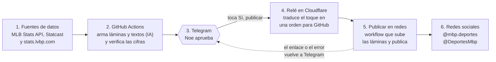
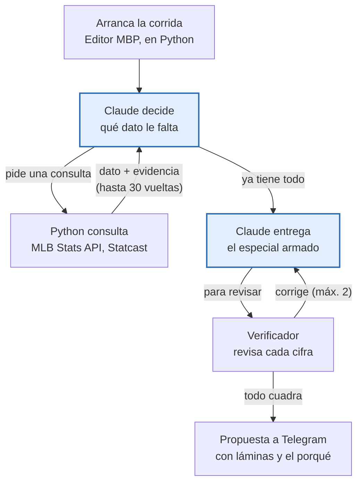

# Cómo funciona MBP (para dummies, pero no tan dummies)

> Versión 0.16.1 · 24 de octubre de 2026. La explicación de todo el sistema en lenguaje sencillo: qué piezas hay, qué hace cada una y por qué está configurado así. El detalle técnico de cada parte está en las demás páginas de la wiki.

## La idea en una frase

Unos robots preparan cada día el contenido de MBP con datos reales, lo mandan al celular por Telegram, y solo sale a Instagram, Threads o X cuando Noe toca "Sí, publicar".

Piénsalo como la cocina de un restaurante:

- **La despensa** son las fuentes de datos (MLB, LVBP, Statcast): de ahí sale la materia prima.
- **Los cocineros** son los programas que corren solos en GitHub: arman las láminas, escriben los textos y revisan que las cifras cuadren.
- **El mesero** es el bot de Telegram: trae el plato a la mesa para probarlo.
- **El mensajero** es el relé: cuando se dice "sí", corre a la cocina a avisar que se sirva.
- **Las mesas** son las redes sociales: ahí llega el plato terminado.

Nada sale de la cocina sin que el chef lo apruebe. Esa es la regla de oro del sistema.

## El recorrido de una publicación

Los pasos 1 a 3 corren solos cada mañana; del 4 en adelante solo arranca cuando se toca el botón. El agente editor entra en el paso 2 cuando se le pide un especial con `/editor` o una nota de voz.

## Por qué hace falta el relé

Porque Telegram y GitHub no hablan el mismo idioma, y GitHub no tiene "oídos": nadie le puede tocar la puerta, solo se le pueden dar órdenes con llave.

**Lo que necesita Telegram.** Cuando se toca un botón, Telegram tiene que avisarle a alguien. Hay dos formas:

- **Webhook:** Telegram llama a una dirección web (https) que debe estar siempre encendida y responder en segundos. Es lo que usamos.
- **Sondeo (polling):** un programa pregunta a Telegram cada pocos segundos "¿alguien tocó algo?". Exige un programa corriendo 24/7.

**Lo que no puede hacer GitHub Actions.** Una corrida no es un servidor: no tiene dirección web, tarda de 20 a 40 segundos en arrancar, trabaja unos minutos y se apaga. Además, para lanzar un workflow, GitHub exige su propio formato (`workflow_dispatch`) y un token en la cabecera. Telegram manda otro formato (`callback_query`) y no sabe poner tokens.

**Lo que hace el relé, en menos de un segundo:**

1. Comprueba la clave secreta del webhook (que el aviso venga de Telegram) y el número de chat (que quien tocó sea Noe).
2. Cambia el mensaje en Telegram: primero "¿Seguro?", después "⏳ Publicando…". Por eso la respuesta se siente inmediata aunque GitHub tarde.
3. Llama a la API de GitHub con el token `mbp-relay` y le pasa qué run, qué pieza y qué redes.
4. Si GitHub dice que no, deja el ❌ con "Reintentar".

**No guarda nada.** Toda la información viaja dentro del propio botón, en un texto corto como `ok:40080411994:1:i:i` (acción, run, pieza, redes elegidas, redes del menú). Telegram limita ese texto a 64 bytes, por eso es tan compacto. Si el relé se reinicia, no se pierde nada.

**Por qué Cloudflare Workers.** Está siempre encendido, arranca en milisegundos, trae https incluido y el plan gratis da 100.000 llamadas al día; usamos unas decenas. No hay servidor que actualizar ni parchar. Las alternativas eran peores: un servidor propio (costo y mantenimiento) o un workflow que revise Telegram cada 5 minutos (demora y minutos gastados).

Desde la 0.16.0 el relé también recibe `/editor <tema>` y las notas de voz: las transcribe con Whisper en Workers AI, muestra lo que entendió y, si se confirma, lanza el editor.

## Por qué todo está en GitHub

Porque GitHub hace cinco trabajos a la vez, gratis, y así no hay que mantener ningún servidor propio. La computadora de Noe puede estar apagada y MBP sigue funcionando.

| Trabajo | Cómo lo hace GitHub | Sin GitHub haría falta |
| --- | --- | --- |
| Guardar el código | El repositorio, con historial de cada cambio y ramas `main`/`develop` | Copias a mano y miedo a romper algo |
| Poner la computadora | Actions presta una máquina Ubuntu limpia por corrida; en repos públicos los minutos son gratis | Un servidor encendido 24/7, pagado y actualizado |
| Guardar archivos | Paquetes de cada corrida (7 días), rama `metricas` y ramas temporales de imágenes | Un disco o almacenamiento en la nube |
| Cuidar las llaves | Secretos cifrados que ni el dueño puede volver a leer, solo reemplazar | Un gestor de claves |
| Dar la hora | Horarios (cron) para resultados, historia, métricas y tokens | Un programador de tareas en un servidor |

**Un bono por ser repositorio público:** las imágenes subidas quedan en una dirección pública (`raw.githubusercontent.com`), que es justo lo que Instagram y Threads exigen para descargarlas.

**Sus límites, y cómo los tapamos:**

- **Los horarios se atrasan,** a veces horas, en momentos de mucha demanda. Por eso las 6 de la mañana las dispara cron-job.org, y los horarios de GitHub quedan de respaldo.
- **No escucha,** no tiene dirección web. Por eso existe el relé.
- **Tarda en arrancar,** entre 20 y 40 segundos más la instalación. Por eso publicar toma uno o dos minutos y no es instantáneo.
- **Los paquetes vencen** a los 7 días. Una pieza más vieja hay que regenerarla.
- **Una cola por grupo:** si varias corridas comparten grupo de concurrencia, GitHub cancela las que esperan. Eso fue lo que se comió la historia del 24 de octubre de 2026, y por eso cada publicación tiene hoy su propio grupo.

## Dónde vive el agente

En ningún lado de forma permanente: el agente existe solo mientras corre el workflow "Editor MBP", unos minutos, y luego se apaga. Está repartido en tres partes.

- **El cerebro** es Claude (Sonnet 5.5 por defecto, variable `MODELO_EDITOR`), en los servidores de Anthropic. Piensa y decide, pero no puede ver internet ni tocar nada por sí solo.
- **Las manos** son nueve herramientas escritas en Python en `src/bpt/editor/`: `calendario`, `box_score`, `tabla_posiciones`, `ranking_equipos`, `buscar_jugador`, `stats_jugador`, `lideres`, `percentiles_statcast` y `calcular`. Son las únicas cosas que el cerebro puede pedir.
- **El cuerpo** es la computadora que GitHub presta para la corrida. Ahí corre el programa que conversa con Claude usando la llave `ANTHROPIC_API_KEY`.

En azul, lo que corre en Anthropic (Claude); el resto corre en la computadora de GitHub.

Cómo es la conversación por dentro:

1. Python le manda a Claude las instrucciones de la marca, el tema (si se pidió) y la lista de herramientas disponibles.
2. Claude no contesta con texto sino con un pedido: "ejecuta `box_score` del juego 778899".
3. Python ejecuta esa herramienta contra MLB Stats API, anota el resultado en un **registro de evidencia** y se lo devuelve a Claude.
4. Se repite hasta que Claude tiene todo y entrega el especial completo: portada, láminas, caption e hilo. Hay topes: 30 vueltas y 40 consultas, para que no gaste sin fin.
5. El verificador compara cada cifra del especial con el registro de evidencia. Si algo no aparece ahí, se lo devuelve a Claude para corregir, hasta 2 veces.
6. Python dibuja las láminas y manda a Telegram la "🧠 Propuesta del editor" con el porqué y otras ideas.

**Por qué así.** Claude nunca escribe un número de memoria: cada cifra tiene que haber salido de una herramienta, y el verificador lo comprueba. Así se evita que la IA invente estadísticas.

**Su memoria entre días** es el archivo `aprendizajes.md` de la rama `metricas`: lo que mejor funcionó en redes la semana anterior. El editor lo lee al arrancar.

**La otra IA, el redactor,** es más simple: no usa herramientas. Recibe los datos ya armados de los resultados del día y escribe el caption y el hilo de una vez; un validador revisa largo, siglas y reglas de marca. Cada llamada a Claude se paga por uso a Anthropic.

## Las piezas, una por una

Son nueve piezas. Ninguna es magia: cada una hace una sola cosa y le pasa el resultado a la siguiente.

| Pieza | Qué es | Qué hace | En la cocina sería |
| --- | --- | --- | --- |
| Fuentes de datos | MLB Stats API, Baseball Savant (Statcast) y stats.lvbp.com | Dan los marcadores, box scores, estadísticas y percentiles. Son gratis y públicas. | La despensa |
| Repositorio en GitHub | La carpeta `beisbol-para-todos`, con todo el código en Python (el paquete `bpt`) | Guarda las recetas: cómo dibujar una lámina, cómo leer un box score, cómo publicar. | El recetario |
| GitHub Actions (workflows) | Programas que GitHub corre en sus computadoras, por horario o cuando alguien los llama | Hacen el trabajo pesado sin que ninguna computadora propia esté prendida. Cada uno tiene un archivo `.yml`. | Los cocineros |
| Redactor (IA) | Claude, vía la API de Anthropic | Escribe el caption de Instagram y el hilo de X a partir de los datos, con las reglas de la marca. | El que escribe la carta |
| Agente editor (IA) | Claude Sonnet con herramientas propias | Busca la historia del día, consulta datos, arma un especial completo y explica por qué lo eligió. | El chef de cocina que propone el plato del día |
| Verificador | Código normal, sin IA | Compara cada cifra del texto con la lámina y con MLB Stats API. Si algo no cuadra, marca alerta. | El que prueba antes de servir |
| Bot de Telegram | Un bot privado que solo le habla a Noe | Manda cada pieza con vista previa y botones para publicar. | El mesero |
| Relé | Un pequeño programa en Cloudflare (Worker) | Escucha los botones de Telegram y le pide a GitHub que corra "Publicar en redes". También entiende `/editor` y notas de voz. | El mensajero |
| Redes sociales | APIs de Instagram, Threads (Meta) y X | Reciben las láminas y los textos y los publican en @mbp.deportes y @DeportesMbp. | Las mesas |

**Los cocineros (workflows) y su turno:**

| Workflow | Cuándo corre | Qué produce |
| --- | --- | --- |
| Resultados MLB | Cada mañana | 3 láminas por juego de ayer + textos, a Telegram |
| Resultados LVBP | Cada mañana (oct a ene) | Carrusel de la jornada + destacados, a Telegram |
| Historia del día | Después de los resultados | Lámina vertical con los juegos de hoy, a Telegram |
| Editor MBP | A mano, por `/editor` o diario si se enciende | Un especial propuesto por la IA, a Telegram |
| Especial MBP | A mano | Especiales armados a mano (JSON), a Telegram |
| Publicar en redes | Cuando se toca "Sí, publicar" | La publicación en las redes elegidas |
| Aviso de publicación cancelada | Si una publicación se cancela | El aviso de fallo con "Reintentar" en Telegram |
| Métricas MBP | Lunes | Informe de cómo le fue a lo publicado y aprendizajes para el editor |
| Renovar tokens | Lunes | Llaves nuevas de Instagram y Threads antes de que venzan |

## Un día típico

Todo arranca solo a las 6 de la mañana; la única intervención humana es aprobar. Horas de Santiago.

1. **06:00** Un despertador externo (cron-job.org, con el token `cron-job-mbp`) le pide a GitHub que corra Resultados MLB y Resultados LVBP. Se usa un despertador externo porque los horarios propios de GitHub se atrasan hasta varias horas.
2. **06:00 a 06:15** Los cocineros bajan los datos de ayer, dibujan las láminas, el redactor escribe los textos y el verificador revisa las cifras. Todo llega a Telegram como "paquete".
3. **Justo después** Corre la Historia del día con los juegos de hoy y también llega a Telegram. Si a las 07:43 no ha salido, un horario de respaldo la genera.
4. **Cuando Noe quiera** Revisa en Telegram, toca la red, confirma con "Sí, publicar" y el relé dispara "Publicar en redes". En uno o dos minutos llega el enlace o el error.
5. **11:43 (opcional)** El editor propone un especial del día, si la variable `EDITOR_DIARIO` está encendida. También se puede pedir con `/editor <tema>` o una nota de voz.
6. **Lunes 09:17** Métricas: cuántos vieron, guardaron y comentaron cada publicación, con aprendizajes que el editor lee después.
7. **Lunes 10:41** Renovación automática de las llaves de Instagram y Threads.

## Por qué cada configuración

Casi todas las configuraciones responden a una de tres preguntas: quién puede hacer qué, cómo se guardan las llaves, y cómo se evita gastar o publicar de más.

**Cuentas y permisos en las redes**

| Configuración | Para qué sirve | Por qué así |
| --- | --- | --- |
| Instagram como cuenta profesional tipo Creador | Publicar por API | Meta solo deja publicar por programa en cuentas profesionales. |
| App de Meta "MBP Publicador" en modo desarrollo | Es la "identidad" del robot ante Meta | En modo desarrollo puede publicar en cuentas propias (Noe es evaluador) sin pasar la revisión de Meta. |
| Permisos `instagram_business_content_publish` y `threads_content_publish` | Publicar | Es el permiso mínimo; los de `insights` son solo para leer métricas. |
| App de X en Pay Per Use, OAuth 1.0a "Read and write" | Publicar en @DeportesMbp | X cobra cada post. OAuth 1.0a usa 4 llaves fijas que no vencen. |
| Rechazo de tuits con enlace | Cuidar el saldo de X | Un tuit con enlace cuesta unas 13 veces más (~US$0,20 contra ~US$0,015). |

**Llaves y secretos**

| Configuración | Para qué sirve | Por qué así |
| --- | --- | --- |
| Secretos de GitHub (`IG_ACCESS_TOKEN`, `X_API_KEY`, `ANTHROPIC_API_KEY`…) | Guardar las llaves cifradas | Nunca van en el código: el repositorio es público. |
| Tokens de Instagram y Threads de 60 días + workflow de los lunes | Que no se venzan | Meta los hace caducar; renovarlos cada semana deja mucho margen. |
| Token `mbp-renovar-token` (permiso Secrets) | Que el workflow guarde el token renovado | El token normal de GitHub no puede reescribir secretos. |
| Token `mbp-relay` (permiso Actions) | Que el relé dispare "Publicar en redes" | Solo puede lanzar workflows: si se filtra, no toca el código ni los secretos. |
| Token `cron-job-mbp` | El despertador de las 6 | Mismo permiso mínimo, para un servicio externo. |

**Telegram y el relé**

| Configuración | Para qué sirve | Por qué así |
| --- | --- | --- |
| Relé en Cloudflare Workers | Recibir los toques de los botones | Telegram avisa a una dirección web siempre encendida. GitHub Actions no puede quedarse escuchando; un Worker sí, y es gratis. |
| `TELEGRAM_WEBHOOK_SECRET` | Que solo Telegram hable con el relé | Sin esa clave, cualquiera que conozca la dirección podría disparar publicaciones. |
| `TELEGRAM_CHAT_ID` | Que solo Noe toque los botones | Si otra persona escribe al bot, recibe "No autorizado". |
| Confirmación "¿Seguro?" | Evitar publicar por un toque accidental | Publicar no se deshace fácil. |
| Workers AI (binding `AI`) | Entender notas de voz | Transcribe con Whisper dentro de Cloudflare. |

**El funcionamiento interno**

| Configuración | Para qué sirve | Por qué así |
| --- | --- | --- |
| Repositorio público | Que Meta descargue las imágenes | La API de Instagram no recibe archivos: pide una URL pública. |
| Rama temporal `publicaciones-<run>` | Alojar los JPEG mientras Meta los copia | Se borra al terminar. Cada publicación tiene la suya, así corren varias a la vez. |
| Rama `metricas` | Libreta de todo lo publicado | El workflow de métricas la lee cada lunes. |
| Paquetes (artefactos) de 7 días | Guardar lo generado entre la mañana y la aprobación | Pasada una semana se borran: ya no se puede reintentar esa pieza. |
| Interruptores `PUBLICAR_INSTAGRAM`, `PUBLICAR_THREADS`, `PUBLICAR_X` | Apagar una red sin tocar código | Variable en 0 o borrada = esa red desaparece del menú. |
| Ramas `main` y `develop` (GitFlow) | Separar producción de pruebas | Solo lo probado entra a `main`, que es lo que genera contenido publicado. |

## Cuando algo falla

Casi siempre la respuesta está en GitHub, pestaña Actions: cada corrida dice en qué paso se cayó.

| Lo que se ve | Lo más probable | Qué hacer |
| --- | --- | --- |
| No llegó nada a Telegram en la mañana | No corrió el despertador, o no hubo juegos | Actions: ver si corrió Resultados. Si no, lanzarlo a mano. |
| "❌ No pude disparar la publicación en GitHub" | El token `mbp-relay` venció o perdió permisos | Generar uno nuevo y guardarlo en los secretos del Worker. |
| Se queda en "⏳ Publicando…" | La corrida se canceló antes de arrancar | Desde la 0.16.1 llega solo el ❌ con "Reintentar". Si no, revisar Actions. |
| ❌ de Instagram o Threads con "token" | La llave de Meta venció | Correr "Renovar tokens" o generar una nueva en Meta. |
| ❌ de X con "créditos" o 402 | Se acabó el saldo de X | Recargar en console.x.com. |
| "no encontré el paquete del run" | Pasaron más de 7 días, o es una corrida sin paquete | Regenerar la pieza: lanzar de nuevo el workflow que la creó. |
| La pieza llega "con alertas" 🔎 | El verificador encontró una cifra dudosa | Leer la alerta antes de publicar. No bloquea: la decisión es humana. |

Comandos de chequeo desde la computadora: `python -m bpt instagram-prueba`, `threads-prueba`, `x-prueba` y `telegram-webhook`.

## Glosario mínimo

| Palabra | Qué significa |
| --- | --- |
| API | Una "ventanilla" por donde un programa le pide algo a otro (datos, publicar) sin pasar por la pantalla. |
| Agente | Una IA que no solo responde: usa herramientas, consulta datos y decide pasos hasta terminar una tarea. |
| Workflow | Una receta que GitHub Actions ejecuta paso a paso en sus computadoras. |
| Corrida (run) | Cada vez que un workflow se ejecuta. Tiene un número, que es como su ticket. |
| Paquete (artefacto) | Los archivos que deja una corrida: láminas, textos y resumen. Duran 7 días. |
| Pieza | Una publicación concreta dentro de un paquete: "1" (primer juego o historia), "jornada" (LVBP), "r1" (su Reel). |
| Relé | Programa intermediario que traduce un toque en Telegram en una orden para GitHub. |
| Webhook | Cuando un servicio avisa a otro llamando a su dirección web, en vez de que el otro pregunte a cada rato. |
| Token | Una llave digital con permisos limitados. Puede vencer y se puede revocar. |
| Secreto | Un token o clave guardado cifrado en GitHub o Cloudflare, invisible incluso para quien lo guardó. |
| Rama | Una versión paralela del código o de los archivos dentro del mismo repositorio. |
| OAuth | La forma estándar de que una app actúe en nombre de una cuenta sin saber su contraseña. |
