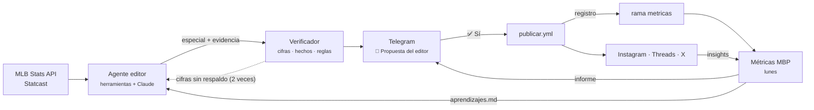

# Editor, métricas y Reels

> Versiones 0.12.0 a 0.15.0 · 21 de octubre de 2026.

Cuatro piezas que cierran el ciclo de la redacción automática: el **verificador** asegura que ninguna cifra de un especial salga sin respaldo, el **editor** propone y arma especiales con datos consultados, las **métricas** dicen qué funcionó y se lo pasan al editor, y los **Reels** convierten cualquier pieza en video con voz.

Principio rector, el mismo de siempre: **el sistema propone y el editor humano decide.** Nada se publica sin el ✅ en Telegram.



## 1. Verificador de especiales (0.12.0)

`src/bpt/verificador.py`. Revisa cada especial en cuatro capas:

| Capa | Qué comprueba | Si falla |
| --- | --- | --- |
| Coherencia | Cada número del caption, el hilo y el guion está en las láminas (o en la evidencia) | Cifra sin respaldo |
| Evidencia | Con `evidencia`, cada número de las láminas aparece en ella (las horas "8:03" cuentan enteras; "2026-27" vale con 2026) | Cifra sin respaldo |
| Hechos | El bloque `verificar` se contrasta con MLB Stats API: `record`, `marcador`, `linea`, `stat_jugador`, `stat_equipo`. Una historia con `marcador.game_pk` se comprueba sola | Alerta con lo que dice cada fuente |
| Reglas de marca | Apuestas, "el mejor" a secas ("el mejor promedio" sí vale), innings con decimal, línea gringa, más de 10 láminas | Alerta |

Nada se bloquea: la pieza llega "con alertas" y el encabezado de Telegram trae la línea `🔎 N cifras revisadas · contra M consultas · K/K hechos confirmados`. Sin evidencia la verificación es parcial y lo dice.

```powershell
python -m bpt verificar --archivo content/especiales/previa-serie-mundial-2026.json
python -m bpt verificar --archivo mi-especial.json --sin-hechos     # sin red
```

Ejemplo de hechos en un especial:

```json
"verificar": [
  {"tipo": "record", "equipo_id": 139, "temporada": 2026, "valor": "98-64"},
  {"tipo": "marcador", "game_pk": 813024, "carreras_v": 3, "carreras_l": 7},
  {"tipo": "linea", "game_pk": 813024, "jugador_id": 691406, "vb": 4, "h": 2, "hr": 1},
  {"tipo": "stat_jugador", "id": 660271, "temporada": 2026, "grupo": "hitting",
   "campo": "homeRuns", "valor": 44}
]
```

Para la LVBP se agrega `"liga_id": 135`.

## 2. Agente editor (0.13.0)

`src/bpt/editor/`. Un bucle de *tool use* con Claude:

1. **Herramientas** (`herramientas.py`), todas estrictas (`strict: true`): `calendario`, `box_score`, `tabla_posiciones`, `ranking_equipos` (con el puesto de cada equipo), `buscar_jugador`, `stats_jugador`, `lideres`, `percentiles_statcast` y `calcular` (calculadora segura, sin `eval`). Cada respuesta exitosa queda en la **evidencia**.
2. **Entrega**: el modelo llama a `entregar_especial` con el especial, el porqué y otras ideas. El programa normaliza el slug (`editor-<fecha>-<tema>`) y corre el verificador contra la evidencia. Si hay cifras sin respaldo o reglas incumplidas, le devuelve la lista para que consulte, calcule o quite (hasta 2 veces).
3. **Paquete**: `bpt.especial.generar_datos` dibuja las láminas y verifica los hechos contra MLB Stats API. Quedan `resumen.json`, `textos.json`, `<slug>.json`, `<slug>.evidencia.json` y `uso.json`.

Por qué una calculadora: un porcentaje calculado "de cabeza" no deja rastro. Calculado con la herramienta, queda en la evidencia y el verificador lo acepta.

Límites del bucle: 30 llamadas al modelo, 40 consultas, 2 devoluciones y 2 recordatorios si termina sin entregar. El sistema y la conversación se cachean (un punto de caché en el sistema y otro móvil en el último mensaje).

Láminas nuevas: `portada_tema` (portada de un tema que no es un duelo: titular, dato grande y hasta 3 de apoyo). `equipos` ahora solo es obligatorio en las láminas de duelo (`portada`, `cara_a_cara`, `camino`, `figuras`).

**Operación**

| Qué | Cómo |
| --- | --- |
| A mano | Actions → **Editor MBP** → *Run workflow* (tema opcional, fecha opcional) |
| Diario | Variable de repo `EDITOR_DIARIO = 1` → 11:43 de Santiago |
| Modelo | Variable `MODELO_EDITOR` (por defecto `claude-sonnet-5-5`); esfuerzo con `BPT_ESFUERZO_EDITOR` |
| Local | `python -m bpt editor [--tema "..."] [--fecha AAAA-MM-DD]` |
| Guardar en el repo | Copiar `<slug>.json` y `<slug>.evidencia.json` del artefacto a `content/especiales/` |

Costo: depende de cuántas consultas haga. Cada corrida imprime tokens y costo estimado en el resumen del run (`uso.json`). Contrastar con *Settings → Billing* tras la primera semana.

### Pedirle al editor desde Telegram (0.16.0)

Además del botón de Actions, el editor se pide desde el chat del bot:

| Mensaje | Qué pasa |
| --- | --- |
| `/editor duelo de abridores del Juego 1` | Dispara **Editor MBP** con ese tema y responde "⏳ armando…" |
| `/editor` | Tema libre: el editor elige la historia |
| Nota de voz ("Gaby, hazme un especial del cañonero de Lara") | El relé la transcribe con Whisper (Workers AI), responde "🎙️ Entendí: «…» ¿Armo el especial?" y dispara solo con ✅ |
| Cualquier otro texto | Responde la ayuda |

Solo responde a `TELEGRAM_CHAT_ID`; cualquier otra persona recibe "No autorizado". Las notas de más de 90 s se rechazan. El tema viaja dentro del mensaje de confirmación: el relé sigue sin guardar nada.

**Configuración (una vez):**

1. Redesplegar el relé con el `worker.js` nuevo.
2. Solo para la voz: en el Worker, **Settings → Bindings → Add → Workers AI**, nombre `AI` (con `wrangler deploy` ya va en `wrangler.toml`). Whisper consume la cuota gratuita diaria de Workers AI; unos audios cortos al día caben de sobra, pero conviene mirarlo en el panel.
3. Volver a registrar el webhook para que Telegram también le mande los mensajes (antes solo mandaba los toques de botones): `python -m bpt telegram-webhook --url https://mbp-telegram-relay.<cuenta>.workers.dev`. Imprime un secreto nuevo: pegarlo en el Worker como `TELEGRAM_WEBHOOK_SECRET` enseguida (mientras tanto los botones responden 401). Verificar con `python -m bpt telegram-webhook`.

## 3. Métricas (0.14.0)

`src/bpt/metricas/`. Tres piezas:

1. **Registro.** `publicar.yml` llama a `publicar-redes --registro` y anota cada publicación exitosa (red, id, formato, hora) en la rama `metricas`, archivo `publicaciones.jsonl`. Los duplicados no se anotan.
2. **Workflow "Métricas MBP"** (lunes 09:17 Santiago y a mano). Pide los números de lo publicado en los últimos 28 días, guarda la foto en `fotos/AAAA-MM-DD.json`, manda el informe con una lámina "¿Qué funciona?" y escribe `aprendizajes.md` (solo con formatos o franjas con 3+ piezas).
3. **Editor.** El workflow del editor trae `aprendizajes.md` de la rama y se lo da al agente.

Métricas normalizadas: **alcance** (reach de Instagram, views de Threads, impresiones de X), **interacciones** y **tasa** (interacciones entre alcance). Formatos: Resultado MLB, Jornada LVBP, Especial, Propuesta del editor, Historia del día, Historia especial y Reel.

**Configuración pendiente (una vez):**

- App de Meta → casos de uso → agregar `instagram_business_manage_insights` y `threads_manage_insights`, y regenerar los tokens (igual que en la configuración inicial). Sin esos permisos, el informe dice qué falta y sigue con las otras redes.
- X cobra cada lectura: unos pocos tuits por semana. Para apagarlo: variable `METRICAS_X = 0`.

## 4. Reels (0.15.0)

`src/bpt/video/reel.py`. Un video 1080x1920 por pieza:

- La lámina arriba (zona segura del perfil), subtítulos debajo y una barra de progreso.
- El guion se parte por sus marcas `[LÁMINA n]`; sin marcas, las frases se reparten en orden entre las láminas.
- Voz: edge-tts con voz venezolana (`es-VE-SebastianNeural`, o `es-VE-PaolaNeural` con `BPT_VOZ`; velocidad con `BPT_VOZ_VELOCIDAD`). Cada lámina dura lo que dura su tramo de voz.
- Sin voz (edge-tts caído): sale mudo con los subtítulos, para ponerle música desde la app. Telegram lo avisa.
- H.264 + AAC 48 kHz, 30 fps, `faststart`.

En Telegram, después del menú de la pieza llega el video y el botón **🎬 Publicar Reel en Instagram** (pieza `r1`, `rjornada`…). Se publica con `media_type=REELS` y `share_to_feed`. El chequeo de duplicado solo cuenta videos (el carrusel de la misma pieza tiene el mismo caption).

**Configuración pendiente (una vez):**

- Variable de repo `REELS = 1` para que los workflows de resultados, especiales y editor armen los Reels.
- **Redesplegar el relé** (`infra/telegram-relay`, `npx wrangler deploy`): la versión nueva acepta las piezas `r…`. Sin redesplegar, el botón del Reel responde "Botón desconocido".
- Instagram descarga el video desde la rama `publicaciones` (igual que las imágenes). Si Meta rechazara el video por el tipo de contenido de raw.githubusercontent.com, la alternativa es alojarlo en otro servidor público.

Edge-tts usa el servicio de voz de Microsoft Edge sin llave: es gratuito pero no oficial y puede cambiar. Si deja de funcionar, los Reels salen mudos y nada más se rompe.

## Pruebas

264 pruebas de Python (`python -m pytest -q`) y 23 del relé (`node --test infra/telegram-relay/worker.test.mjs`). El editor se prueba con un modelo y una MLB Stats API simulados; los Reels, con ffmpeg real y voz simulada.
