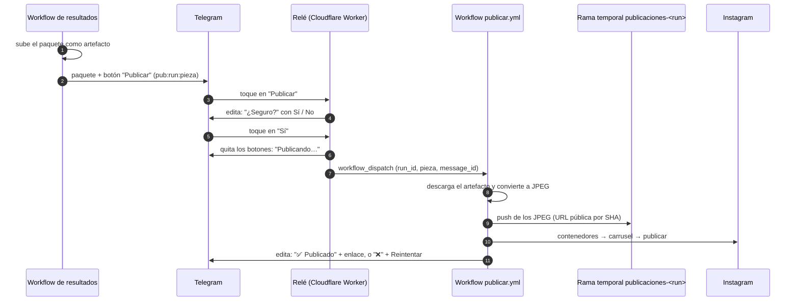

# Publicación en Instagram (Fase 4)

Desde la versión 0.6.0 cada pieza del paquete diario llega a Telegram con un botón **📸 Publicar en Instagram**. Al tocarlo, el bot pide confirmación; al confirmar, la pieza se publica en la cuenta y el mismo mensaje se actualiza con el enlace al post. Nada se publica sin dos toques explícitos del editor.

> Desde la versión 0.8.0 el mismo botón puede publicar también en Threads y X: ver [Publicación en Threads y X](Publicacion-en-Threads-y-X).

Una pieza es un carrusel con su caption:

- **MLB:** una por juego (láminas de resultado, figuras y latinos), con identificador `1`, `2`… según el orden del paquete.
- **LVBP:** una sola, la de la jornada (marcadores y destacados), con identificador `jornada`. Los extras por juego siguen siendo material para historias y se publican a mano.

Una pieza sin caption (falló el redactor) o sin láminas no lleva botón.

## Flujo

Componentes:

| Componente | Archivo | Responsabilidad |
| --- | --- | --- |
| Botón en el paquete | `src/bpt/notificar/telegram.py` (`ofrecer_publicar`) | Añade el botón al final de cada pieza, solo si la variable `PUBLICAR_INSTAGRAM` del repositorio vale `1` |
| Relé | `infra/telegram-relay/worker.js` | Verifica el origen y el autor del toque, pide confirmación y dispara el workflow; no publica ni almacena nada |
| Workflow de publicación | `.github/workflows/publicar.yml` | Descarga el paquete, prepara los JPEG, los hace públicos, publica y avisa |
| Cliente de Instagram | `src/bpt/publicar/instagram.py` | Contenedores, carrusel, espera de procesamiento, publicación, enlace, cuota y control de duplicados |
| Piezas | `src/bpt/publicar/piezas.py` | Determina qué se puede publicar de un paquete y convierte PNG a JPEG |
| Renovación del token | `.github/workflows/instagram-token.yml` | Cada lunes renueva el token de Instagram y lo guarda en el secreto |

## Decisiones de diseño

**Un relé mínimo en lugar de un servicio completo.** Telegram necesita una URL siempre disponible para avisar de cada toque. La alternativa evaluada fue un servicio en Cloud Run con la lógica de publicación. Se optó por un Cloudflare Worker de unas cien líneas que solo traduce el toque en un `workflow_dispatch`, por tres razones: no requiere facturación en la nube (el plan gratuito cubre 100.000 peticiones diarias), no tiene arranque en frío, y toda la lógica de negocio permanece en Python dentro del repositorio, con las mismas pruebas y el mismo entorno que el resto del sistema. El costo es una latencia de 40 a 90 segundos entre el toque y la publicación, mientras arranca el runner de Actions; para contenido diario es irrelevante.

**El retraso del cron no afecta.** Los atrasos observados en GitHub Actions afectan a los disparos programados (`schedule`); los `workflow_dispatch` se ejecutan de inmediato.

**Imágenes públicas desde el propio repositorio.** La API de Instagram no recibe archivos: descarga cada imagen desde una URL pública. Como el repositorio es público, el workflow sube los JPEG a una rama temporal `publicaciones-<run>` y usa `raw.githubusercontent.com` con el SHA del commit en la URL (inmutable, sin problemas de caché). La rama se borra al terminar la corrida, así que no se acumula nada y varias publicaciones pueden correr a la vez (desde la 0.16.1; antes era una sola rama `publicaciones` con una publicación a la vez, y GitHub cancelaba en silencio las que quedaban en cola). Las imágenes son las mismas que se publican, así que exponerlas no revela nada.

**Confirmación en dos toques.** El primer toque solo cambia el mensaje a "¿Seguro?"; el segundo quita los botones antes de disparar el workflow, lo que impide una publicación doble por un toque repetido.

**Control de duplicados sin estado.** Antes de publicar, el cliente revisa los últimos diez posts de la cuenta; si alguno tiene exactamente el mismo caption, devuelve ese enlace en lugar de publicar de nuevo. Esto cubre reintentos tras una falla parcial sin necesidad de una base de datos.

**Activación con un interruptor.** El botón solo aparece cuando la variable de repositorio `PUBLICAR_INSTAGRAM` vale `1`. Así el código pudo llegar a `main` antes de completar la configuración en Meta y Cloudflare, sin mostrar botones que no responderían.

**Instagram Login y no Facebook Login.** Desde 2024 la API permite publicar con una cuenta profesional (Creador o Empresa) sin vincularla a una página de Facebook. Se usan los permisos `instagram_business_basic` e `instagram_business_content_publish` sobre `graph.instagram.com`.

## Configuración inicial

Requisitos: cuenta de Instagram profesional (tipo Creador), cuenta en Meta for Developers y cuenta gratuita en Cloudflare.

### 1. Meta: aplicación y token

1. En [developers.facebook.com](https://developers.facebook.com/) crear una aplicación de tipo **Business** y agregarle el producto **Instagram**.
2. En **Roles de la app → Roles → Evaluadores de Instagram**, invitar a la cuenta `mbp.deportes`.
3. En Instagram, **Configuración → Apps y sitios web → Invitaciones de evaluador**, aceptar la invitación.
4. En la aplicación, **Instagram → Configuración de la API con inicio de sesión empresarial de Instagram**, pulsar **Generar token** junto a la cuenta. Es un token de larga duración (60 días).
5. Guardar el token en el `.env` como `IG_ACCESS_TOKEN=...` y verificarlo con `python -m bpt instagram-prueba`. El comando muestra la cuenta, el `IG_USER_ID` y la cuota usada, sin publicar nada.

En modo desarrollo la aplicación solo puede publicar en cuentas con rol en ella, que es exactamente el caso de uso. No se requiere revisión de la aplicación por parte de Meta.

### 2. GitHub: secretos y token de renovación

| Secreto | Valor |
| --- | --- |
| `IG_ACCESS_TOKEN` | El token del paso anterior |
| `IG_USER_ID` | Opcional; el que muestra `bpt instagram-prueba` (ahorra una llamada) |
| `GH_PAT_SECRETOS` | Token *fine-grained* solo para este repositorio con el permiso **Secrets: Read and write**. Lo usa la renovación semanal |

El relé necesita además un token *fine-grained* con **Actions: Read and write**. Puede reutilizarse el creado para cron-job.org o crearse uno exclusivo; se recomienda uno exclusivo para poder revocarlos por separado.

### 3. Cloudflare: el relé

1. En el panel de Cloudflare: **Workers & Pages → Create → Worker**, nombre `mbp-telegram-relay`. Reemplazar el código por el de `infra/telegram-relay/worker.js` y desplegar. La URL queda como `https://mbp-telegram-relay.<cuenta>.workers.dev`; al abrirla en el navegador debe responder `MBP relay ok`.
2. Conectar Telegram con el relé desde la carpeta del proyecto: `python -m bpt telegram-webhook --url https://mbp-telegram-relay.<cuenta>.workers.dev`. El comando genera e imprime un secreto compartido.
3. En el Worker, **Settings → Variables and Secrets**, crear como *Secret*: `TELEGRAM_BOT_TOKEN`, `TELEGRAM_CHAT_ID`, `TELEGRAM_WEBHOOK_SECRET` (el valor impreso en el paso 2) y `GITHUB_TOKEN` (el token con permiso de Actions). Como variable de texto: `GITHUB_REPO = nolotov/beisbol-para-todos`.
4. Verificar con `python -m bpt telegram-webhook` (sin argumentos): debe mostrar la URL del relé y ningún error.

Como alternativa al panel, desde `infra/telegram-relay/`: `npx wrangler deploy` y `npx wrangler secret put NOMBRE` para cada secreto.

### 4. Activar el botón

En GitHub, **Settings → Secrets and variables → Actions → Variables**, crear `PUBLICAR_INSTAGRAM = 1`. El paquete del día siguiente ya trae los botones. Para probar sin esperar, lanzar a mano el workflow de resultados de la LVBP.

Para desactivar la publicación basta con borrar la variable o ponerla en `0`.

## Operación

- **Publicar:** tocar **📸 Publicar en Instagram**, revisar que sea la pieza correcta y tocar **✅ Sí, publicar**. En uno o dos minutos el mensaje muestra el enlace al post.
- **Corregir antes de publicar:** si el caption necesita cambios, no usar el botón: publicar a mano con las láminas originales del paquete, como antes. La edición del caption desde Telegram queda como mejora futura.
- **Piezas con alertas:** el mensaje del botón lo indica con "⚠️ con alertas". El botón funciona igual; la decisión es del editor.
- **Publicar a mano desde GitHub:** Actions → **Publicar en redes** → *Run workflow*, con el número del run de resultados (aparece en su URL) y la pieza. Sin `message_id` no se actualiza ningún mensaje.

Fallas habituales y su significado (el mensaje de Telegram las indica y ofrece **🔁 Reintentar**):

| Mensaje | Causa | Acción |
| --- | --- | --- |
| "el token de Instagram venció o es inválido" | Pasaron 60 días sin renovar, o se revocó | Generar un token nuevo en Meta y actualizar `IG_ACCESS_TOKEN` |
| "no encontré el paquete del run" | El artefacto venció (30 días) o el toque llegó antes de que terminara de subirse | Reintentar; si venció, regenerar el día |
| "Instagram no pudo descargar la imagen" | La URL pública no respondía | Reintentar |
| "se alcanzó el límite de publicaciones" | Cuota de 24 horas agotada | Esperar; `bpt instagram-prueba` muestra el uso |
| "No pude disparar la publicación en GitHub (HTTP 401/403)" | Token del relé vencido o sin permiso de Actions | Renovar el token y actualizar `GITHUB_TOKEN` en el Worker |
| Tocar el botón no hace nada | Relé caído o webhook desconectado | `bpt telegram-webhook` muestra el estado y el último error |

Nota: con el relé conectado, Telegram deja de entregar mensajes por `getUpdates`, por lo que `bpt telegram-chat` deja de funcionar. Para usarlo: `bpt telegram-webhook --quitar`, ejecutar el comando y volver a conectar el relé.

## Historia del día

Además de los carruseles, cada día con juegos llega una **historia** (1080×1920) con la cartelera de hoy de la MLB y la LVBP, en hora de Venezuela. La genera `historia.yml` y se publica por el mismo camino: botón **📲 Publicar historia en Instagram** → confirmación → relé → `publicar.yml`.

- **Cuándo llega:** al terminar el primer workflow de resultados del día (`workflow_run`), así que no requiere otro disparo en cron-job.org. Si ese día no corrió ningún resultado (temporada regular de MLB, por ejemplo), la manda el cron de respaldo de las 07:43 de Santiago. Un segundo disparo el mismo día no la repite; lanzarla a mano desde Actions sí la regenera.
- **Sin juegos, nada:** si no hay juegos de ninguna de las dos ligas no se dibuja la lámina ni llega mensaje a Telegram (el resumen del run lo dice).
- **Qué muestra:** hora (o estado, si el juego se pospuso), enfrentamiento, fase y estado de la serie en postemporada MLB o récords en la LVBP, y abridores probables. Con muchos juegos la lámina pasa a filas compactas. El contenido queda dentro de las zonas seguras de las historias.
- **Pieza "1":** dentro de un paquete de historia la única pieza tiene id `1`. Así el relé de Cloudflare no necesita cambios: su expresión ya acepta ese valor, y `publicar.yml` distingue la historia por el `formato` del paquete.
- **API:** contenedor con `media_type=STORIES` y sin caption. Las historias no tienen caption con qué comparar, así que no hay chequeo de duplicado; el doble toque lo evita el relé, que quita los botones antes de disparar. El mensaje de Telegram queda con "✅ Historia publicada" y el enlace a las historias del perfil.
- **Artefacto:** se guarda 7 días (la historia solo tiene sentido el mismo día).

## Seguridad

| Secreto | Dónde vive | Riesgo si se filtra | Revocación |
| --- | --- | --- | --- |
| `IG_ACCESS_TOKEN` | GitHub Secrets, `.env` | Publicar en la cuenta de Instagram | Meta for Developers → la app → quitar la cuenta o restablecer el secreto de la app |
| `GH_PAT_SECRETOS` | GitHub Secrets | Sobrescribir secretos del repositorio | GitHub → Settings → Developer settings → Fine-grained tokens |
| `GITHUB_TOKEN` del relé | Cloudflare | Disparar workflows del repositorio | Igual que el anterior |
| `TELEGRAM_WEBHOOK_SECRET` | Cloudflare, Telegram | Enviar toques falsos al relé (que igual exige el `chat_id` del editor) | Volver a ejecutar `bpt telegram-webhook --url …` y actualizar el Worker |

Controles aplicados:

- **El relé rechaza todo lo que no venga de Telegram** (cabecera secreta) y todo toque de un usuario distinto al `TELEGRAM_CHAT_ID`.
- **Entradas validadas en tres puntos:** el relé solo acepta `pub|ok|no:<número>:<1-2 dígitos o jornada>`; el workflow vuelve a validar con expresiones regulares antes de usar las entradas, que además se pasan por variables de entorno y nunca interpoladas en scripts; y Python valida el identificador de la pieza.
- **El workflow solo acepta runs de los workflows de resultados o de la historia del día**, comprobando el nombre antes de descargar.
- **Permisos acotados:** `publicar.yml` tiene `contents: write` (para la rama temporal de cada publicación) y `actions: read`; los workflows de resultados siguen con `contents: read`.
- **El token de Instagram nunca aparece en registros:** los errores lo reemplazan por `<token>` (verificado por pruebas) y el token renovado se enmascara con `::add-mask::` antes de guardarlo.

## Límites conocidos

- **Cuota de Instagram:** la documentación de Meta indica 100 publicaciones por API en 24 horas móviles (un carrusel cuenta como una), aunque otra sección menciona 50. Con 2 a 5 piezas diarias ambos márgenes sobran.
- **Solo JPEG, hasta 10 imágenes por carrusel**, todas recortadas según la proporción de la primera. Las láminas son 1080×1350 (4:5), dentro del rango aceptado.
- **Caption de hasta 2.200 caracteres y 30 hashtags.** El validador del redactor alerta cuando el caption pasa de 1.200; el cliente comprueba el límite real antes de llamar a la API.
- **Sin edición del caption desde Telegram.** Para corregir hay que publicar a mano.
- **Threads y X:** desde la 0.8.0, en su propia página: [Publicación en Threads y X](Publicacion-en-Threads-y-X).

## Fuentes

- [Instagram Platform: Content Publishing](https://developers.facebook.com/docs/instagram-platform/content-publishing)
- [Instagram Platform: refresh_access_token](https://developers.facebook.com/docs/instagram-platform/reference/refresh_access_token)
- [Telegram Bot API: setWebhook y callback queries](https://core.telegram.org/bots/api#setwebhook)
- [GitHub REST API: crear un evento workflow_dispatch](https://docs.github.com/en/rest/actions/workflows#create-a-workflow-dispatch-event)

## Varias piezas seguidas y corridas canceladas (0.16.1)

- **Se pueden aprobar varias piezas seguidas.** Cada corrida de "Publicar en redes" sube sus JPEG a su propia rama temporal y la borra al final, así que corren en paralelo. El grupo de concurrencia es `publicar-<run>-<pieza>-<redes>`: solo frena el doble toque de la misma pieza en las mismas redes.
- **Por qué cambió.** Con un grupo único, GitHub deja una sola corrida en espera y cancela la anterior sin que arranque ningún paso. El 24-oct-2026 se aprobaron tres piezas en un minuto y la historia del día se quedó en "⏳ Publicando…" para siempre.
- **Aviso de publicación cancelada** (`aviso-publicar.yml`). Si una corrida termina cancelada, por tiempo o sin poder arrancar, este workflow lee la pieza y el mensaje del título de la corrida (`Publicar · run … · pieza … · redes … · msg …`) y deja en Telegram el ❌ con "🔁 Reintentar". No avisa si otra corrida igual salió bien o sigue en marcha.
- **Publicar a mano sin Telegram:** en Actions, "Publicar en redes" con el `run_id` del run que **tiene el paquete** (las reruns de "Historia del día" que dicen "ya salió" no generan artefacto) y `message_id` vacío.
